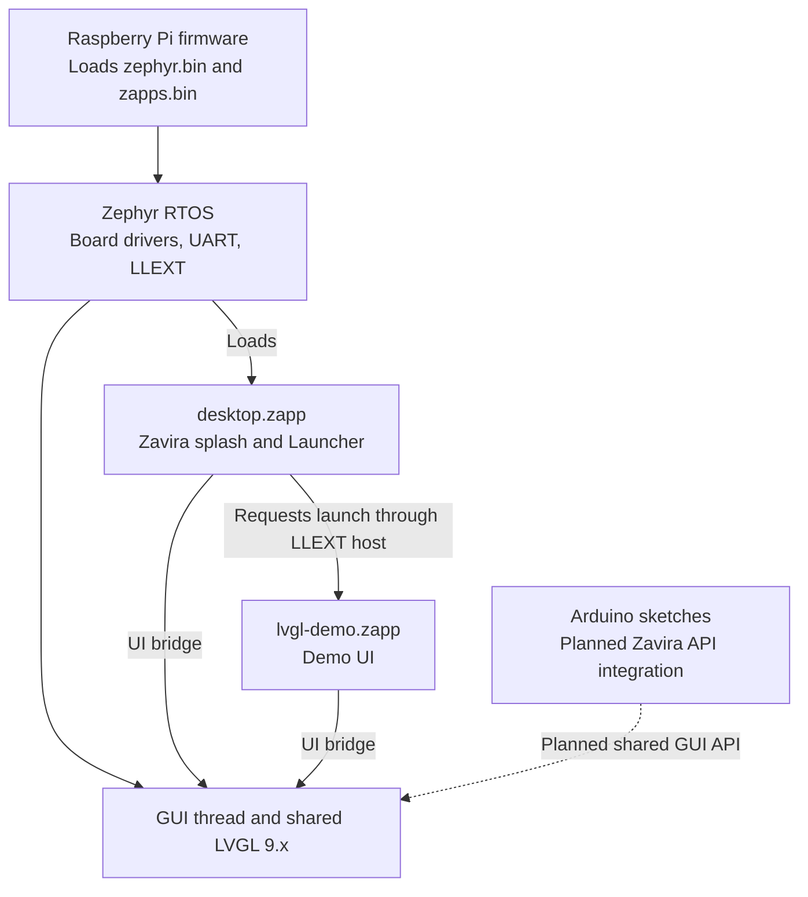
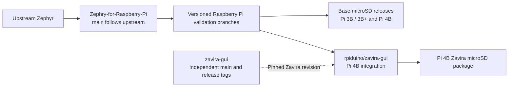

# Zyphry for Raspberry Pi and Zavira GUI

Zyphry for Raspberry Pi provides the Zephyr board support and boot images. Zavira GUI provides a reusable LVGL desktop and application UI. The Raspberry Pi integration combines them in a boot package.

## Runtime architecture

The Pi 4B prototype keeps the pinwheel, Launcher layout, and demo graphics in the ZAPP modules. The kernel provides the LVGL runtime, UI bridge, and loader. Pi firmware reads the two modules as a single `zapps.bin` payload at boot. COM3 provides heartbeat, `DEBUG`, and `RESET`, plus `OPEN LVGL` and `DESKTOP` for the GUI prototype.

## GitHub repositories

- **[Zephry-for-Raspberry-Pi](https://github.com/hypersolver/Zephry-for-Raspberry-Pi)** owns the Raspberry Pi port, boot packaging, and hardware validation. Pi 3B and 3B+ share a base boot package. Pi 4B uses its own image. Pi 5 hardware validation is planned.
- **[zavira-gui](https://github.com/hypersolver/zavira-gui)** is the independent home for core APIs, theme, desktop, examples, and platform adapters. Work starts from `main` in short-lived feature branches and returns through pull requests. Zavira releases have their own version tags.
- **[`rpiduino/zavira-gui`](https://github.com/hypersolver/Zephry-for-Raspberry-Pi/tree/rpiduino/zavira-gui)** is the Pi 4B integration branch. The integration pins compatible Zephyr, LVGL, and Zavira revisions and package the desktop and demo alongside the kernel.

## Validation status

The base boot and UART heartbeat have been exercised on Pi 3B, Pi 3B+, and Pi 4B. The Zavira prototype has been built for Pi 4B, and QEMU has verified the animated splash, Launcher, Demo switching, heartbeat, and `DEBUG`. Pi 4B HDMI and `RESET` for the Zavira image and Arduino integration are pending.

The base boot ZIPs are available in the [base firmware release](https://github.com/hypersolver/Zephry-for-Raspberry-Pi/releases/tag/rpiduino-v4.5.0-base). See the [Pi 4B integration and build instructions](zavira-pi4/README.md).
